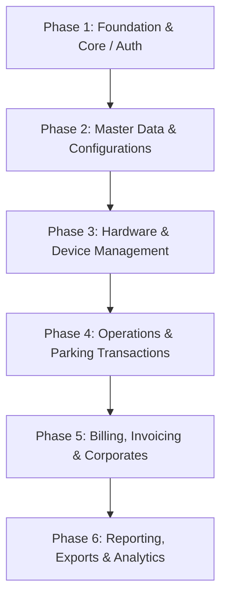

# PMS NestJS - API Migration & Transfer Roadmap (1-by-1 Execution Plan)

> **Document Status**: READY FOR 1-BY-1 MIGRATION  
> **Source Project**: `pms-nest` (`e:\projects\pms\pms-nest`)  
> **Total Controllers**: 13  
> **Total API Endpoints**: 27  
> **Note**: For now, koi code transfer nahi kiya gaya hai. Yeh complete reference & checklist document hai jiske mutabiq ek ek kar k API transfer ki ja sakti hai.

---

## 📋 Recommended Phased Migration Order (Dependencies First)

Jab transfer shuru karein, toh recommended sequence yeh honi chahiye taake dependencies missing na hon:

1. **Phase 1: Foundation & Auth** (Base setup, Login, Profile)
2. **Phase 2: Master & Settings** (Parking Sites, Payment Gateways, File Upload)
3. **Phase 3: Hardware & Devices** (Handheld POS tags/untags, device registry)
4. **Phase 4: Operations & Transactions** (Handheld receipts, checkouts, shift closings)
5. **Phase 5: Corporate & Billing** (Corporate entities, corporate cards, invoice generation)
6. **Phase 6: Dashboard & Reports** (Executive dashboard stats, PDF & Excel exports)

---

## 🛠️ Per-API Transfer Checklist Standard (1-by-1 Protocol)

Har endpoint transfer karte waqt in steps ko follow kiya jaye:

- [ ] **1. DTOs & Validation**: Target project mein request DTO create karein with `class-validator` rules.
- [ ] **2. Database Entities / Migrations**: Relevant Objection.js / TypeORM / Prisma models verify karein.
- [ ] **3. Service Logic**: Business logic, database queries, transactions transfer karein.
- [ ] **4. Controller Route**: Endpoint method (`GET`, `POST`, `PATCH`, `DELETE`) define karein with standard decorators (`@Public()`, `@Req()`, `@Res()`, `@AuthId()`).
- [ ] **5. Response Standard**: `ResponseHelper.success()` aur `ResponseHelper.error()` structure adhere karein.
- [ ] **6. Testing**: cURL / Postman request run kar k status code aur payload verify karein.

---

## 📑 Complete API Inventory & Tracking Checklist

---

### Phase 1: Foundation & Authentication

#### 1. App Controller (`/api`)
- **Controller File**: [src/app.controller.ts](file:///e:/projects/pms/pms-nest/src/app.controller.ts)
- **Service File**: [src/app.service.ts](file:///e:/projects/pms/pms-nest/src/app.service.ts)

| # | Status | Method | Endpoint | Auth | Request DTO / Params | Description |
|---|---|---|---|---|---|---|
| 1.1 | [ ] Pending | `GET` | `/api` | `@Public()` | None | Health check / API ping greeting |
| 1.2 | [ ] Pending | `GET` | `/api/test` | Authenticated | None | Production environment connection test |

---

#### 2. Auth Module (`/api/auth`)
- **Controller File**: [src/auth/auth.controller.ts](file:///e:/projects/pms/pms-nest/src/auth/auth.controller.ts)
- **Service File**: [src/auth/auth.service.ts](file:///e:/projects/pms/pms-nest/src/auth/auth.service.ts)
- **DTOs**: [src/auth/dto/auth.dto.ts](file:///e:/projects/pms/pms-nest/src/auth/dto/auth.dto.ts)

| # | Status | Method | Endpoint | Auth | Request DTO / Params | Description |
|---|---|---|---|---|---|---|
| 2.1 | [ ] Pending | `POST` | `/api/auth/login` | `@Public()` | Body: `LoginDto` (`username`, `password`) | Portal admin/user login + JWT generation |
| 2.2 | [ ] Pending | `POST` | `/api/auth/parkingSystem/login` | `@Public()` | Body: `LoginDto` (`username`, `password`) | Handheld / POS parking system login |
| 2.3 | [ ] Pending | `POST` | `/api/auth/send-email` | `@Public()` | Body: `SendEmailDto` (`to`, `subject`, `text/html`) | Core email notification sending service |

---

#### 3. Users Module (`/api/users`)
- **Controller File**: [src/users/users.controller.ts](file:///e:/projects/pms/pms-nest/src/users/users.controller.ts)
- **Service File**: [src/users/users.service.ts](file:///e:/projects/pms/pms-nest/src/users/users.service.ts)
- **DTOs**: [src/users/dto/update-profile.dto.ts](file:///e:/projects/pms/pms-nest/src/users/dto/update-profile.dto.ts)

| # | Status | Method | Endpoint | Auth | Request DTO / Params | Description |
|---|---|---|---|---|---|---|
| 3.1 | [ ] Pending | `GET` | `/api/users/profile` | Authenticated | Header: Bearer Token (`userId`) | Get profile details of the logged-in user |
| 3.2 | [ ] Pending | `PATCH` | `/api/users/profile` | Authenticated | Body: `UpdateProfileDto` | Update profile information of the logged-in user |

---

### Phase 2: Master Data, Configurations & Storage

#### 4. Parking Sites Module (`/api/parking-sites`)
- **Controller File**: [src/parking-sites/parking-sites.controller.ts](file:///e:/projects/pms/pms-nest/src/parking-sites/parking-sites.controller.ts)
- **Service File**: [src/parking-sites/parking-sites.service.ts](file:///e:/projects/pms/pms-nest/src/parking-sites/parking-sites.service.ts)
- **DTOs**: [src/parking-sites/dto/search-parking-sites.dto.ts](file:///e:/projects/pms/pms-nest/src/parking-sites/dto/search-parking-sites.dto.ts)

| # | Status | Method | Endpoint | Auth | Request DTO / Params | Description |
|---|---|---|---|---|---|---|
| 4.1 | [ ] Pending | `GET` | `/api/parking-sites/dropdown` | `@Public()` | None | Sites dropdown list for selection |
| 4.2 | [ ] Pending | `POST` | `/api/parking-sites/dropdown` | `@Public()` | None | Sites dropdown list (POST alias) |
| 4.3 | [ ] Pending | `POST` | `/api/parking-sites/paginated` | Authenticated | Body: `SearchParkingSitesDto`, Query: `page, perPage` | Paginated listing of parking sites with stats |
| 4.4 | [ ] Pending | `GET` | `/api/parking-sites/site-dropdown` | Authenticated | None | Detailed site dropdown including lanes/configs |
| 4.5 | [ ] Pending | `DELETE` | `/api/parking-sites/delete/:id` | Authenticated | Param: `id` (int) | Delete parking site along with related configuration |

---

#### 5. Payment Gateways Module (`/api/payment-gateways`)
- **Controller File**: [src/payment-gateway/payment-gateway.controller.ts](file:///e:/projects/pms/pms-nest/src/payment-gateway/payment-gateway.controller.ts)
- **Service File**: [src/payment-gateway/payment-gateway.service.ts](file:///e:/projects/pms/pms-nest/src/payment-gateway/payment-gateway.service.ts)
- **DTOs**: `create-payment-gateway.dto.ts`, `update-payment-gateway.dto.ts`, `payment-gateway-paginated.dto.ts`

| # | Status | Method | Endpoint | Auth | Request DTO / Params | Description |
|---|---|---|---|---|---|---|
| 5.1 | [ ] Pending | `POST` | `/api/payment-gateways/create` | Authenticated | Body: `CreatePaymentGatewayDto` | Configure a new payment gateway |
| 5.2 | [ ] Pending | `POST` | `/api/payment-gateways/paginated` | Authenticated | Body: `PaymentGatewayPaginatedDto`, Query: `page, perPage` | Paginated list of payment gateways |
| 5.3 | [ ] Pending | `GET` | `/api/payment-gateways/detail/:id` | Authenticated | Param: `id` (int) | Get single payment gateway details |
| 5.4 | [ ] Pending | `PATCH` | `/api/payment-gateways/update` | Authenticated | Body: `UpdatePaymentGatewayDto` | Update payment gateway settings |
| 5.5 | [ ] Pending | `DELETE` | `/api/payment-gateways/delete/:id` | Authenticated | Param: `id` (int) | Remove/delete payment gateway configuration |

---

#### 6. Files Upload Module (`/api/files-upload`)
- **Controller File**: [src/files-upload/files-upload.controller.ts](file:///e:/projects/pms/pms-nest/src/files-upload/files-upload.controller.ts)
- **Service File**: [src/files-upload/files-upload.service.ts](file:///e:/projects/pms/pms-nest/src/files-upload/files-upload.service.ts)
- **DTOs**: [src/files-upload/dto/files-upload.dto.ts](file:///e:/projects/pms/pms-nest/src/files-upload/dto/files-upload.dto.ts)

| # | Status | Method | Endpoint | Auth | Request DTO / Params | Description |
|---|---|---|---|---|---|---|
| 6.1 | [ ] Pending | `POST` | `/api/files-upload` | `JwtAuthGuard` | Multipart/form-data. File: `media`, Body: `FileUploadDto` | Cloudflare R2 / AWS S3 global media uploader |

---

### Phase 3: Hardware & Device Management

#### 7. Hardware Module (`/api/hardware`)
- **Controller File**: [src/hardware/hardware.controller.ts](file:///e:/projects/pms/pms-nest/src/hardware/hardware.controller.ts)
- **Service File**: [src/hardware/hardware.service.ts](file:///e:/projects/pms/pms-nest/src/hardware/hardware.service.ts)
- **DTOs**: `create-hardware.dto.ts`, `hardware-filter.dto.ts`, `hardware-paginated.dto.ts`, `tag-hardware.dto.ts`, `untag-hardware.dto.ts`, `update-hardware.dto.ts`

| # | Status | Method | Endpoint | Auth | Request DTO / Params | Description |
|---|---|---|---|---|---|---|
| 7.1 | [ ] Pending | `GET` | `/api/hardware/handheld-list-by-site` | `@Public()` | Query: `HardwareFilterDto` (`siteId`) | Active handheld devices filtered by site |
| 7.2 | [ ] Pending | `POST` | `/api/hardware/handheld-paginated` | Authenticated | Body: `HardwarePaginatedDto`, Query: `page, perPage` | Paginated listing of handheld terminals |
| 7.3 | [ ] Pending | `POST` | `/api/hardware/create` | Authenticated | Body: `CreateHardwareDto`, `@AuthId()` | Register new hardware device |
| 7.4 | [ ] Pending | `PATCH` | `/api/hardware/update/:id` | Authenticated | Param: `id`, Body: `UpdateHardwareDto`, `@AuthId()` | Update hardware details / serial number |
| 7.5 | [ ] Pending | `PATCH` | `/api/hardware/untag/:id` | Authenticated | Param: `id`, Body: `UntagHardwareDto`, `@AuthId()` | Untag handheld device from user/lane |
| 7.6 | [ ] Pending | `PATCH` | `/api/hardware/tag/:id` | Authenticated | Param: `id`, Body: `TagHardwareDto`, `@AuthId()` | Tag/assign handheld device to user/lane |

---

### Phase 4: Operations & Parking Transactions

#### 8. Handheld Payment Receipts (`/api/handheld-payment-receipts`)
- **Controller File**: [src/handheld-payment-receipts/handheld-payment-receipts.controller.ts](file:///e:/projects/pms/pms-nest/src/handheld-payment-receipts/handheld-payment-receipts.controller.ts)
- **Service File**: [src/handheld-payment-receipts/handheld-payment-receipts.service.ts](file:///e:/projects/pms/pms-nest/src/handheld-payment-receipts/handheld-payment-receipts.service.ts)
- **DTOs**: `add-handheld-receipt.dto.ts`, `shift-summary.dto.ts`

| # | Status | Method | Endpoint | Auth | Request DTO / Params | Description |
|---|---|---|---|---|---|---|
| 8.1 | [ ] Pending | `POST` | `/api/handheld-payment-receipts/handheld-add` | `@Public()` | Multipart/form-data. File: `onlinePaymentReference`, Body: `AddHandheldReceiptDto` | Record new manual/handheld payment receipt |
| 8.2 | [ ] Pending | `POST` | `/api/handheld-payment-receipts/ticket-checkout` | `@Public()` | Multipart/form-data. File: `onlinePaymentReference`, Body: `TicketEaseDto` | Parking ticket settlement & checkout via handheld |
| 8.3 | [ ] Pending | `POST` | `/api/handheld-payment-receipts/handheld-batch` | `@Public()` | Multipart/form-data. File: `file` (CSV) | Offline batch sync for handheld receipts |
| 8.4 | [ ] Pending | `POST` | `/api/handheld-payment-receipts/check-out-batch` | `@Public()` | Multipart/form-data. File: `file` (CSV) | Offline batch sync for ticket checkouts |
| 8.5 | [ ] Pending | `POST` | `/api/handheld-payment-receipts/shift-summary` | `@Public()` | Body: `ShiftSummaryDto` | Operator shift collection summary & totals |

---

#### 9. Parking Shift Closing (`/api/shift-closing`)
- **Controller File**: [src/parking-shift-closing/parking-shift-closing.controller.ts](file:///e:/projects/pms/pms-nest/src/parking-shift-closing/parking-shift-closing.controller.ts)
- **Service File**: [src/parking-shift-closing/parking-shift-closing.service.ts](file:///e:/projects/pms/pms-nest/src/parking-shift-closing/parking-shift-closing.service.ts)

| # | Status | Method | Endpoint | Auth | Request DTO / Params | Description |
|---|---|---|---|---|---|---|
| 9.1 | [ ] Pending | `GET` | `/api/shift-closing/detail/:id` | Authenticated | Param: `id` (int) | Retrieve full details & breakdown of a shift closing |
| 9.2 | [ ] Pending | `DELETE` | `/api/shift-closing/delete/:id` | Authenticated | Param: `id` (int) | Cascade delete shift closing record, details & history |

---

### Phase 5: Billing, Corporate Clients & RFID Cards

#### 10. Corporates Module (`/api/corporates`)
- **Controller File**: [src/corporates/corporates.controller.ts](file:///e:/projects/pms/pms-nest/src/corporates/corporates.controller.ts)
- **Service File**: [src/corporates/corporates.service.ts](file:///e:/projects/pms/pms-nest/src/corporates/corporates.service.ts)
- **DTOs**: [src/corporates/dto/generate-invoice.dto.ts](file:///e:/projects/pms/pms-nest/src/corporates/dto/generate-invoice.dto.ts)

| # | Status | Method | Endpoint | Auth | Request DTO / Params | Description |
|---|---|---|---|---|---|---|
| 10.1 | [ ] Pending | `GET` | `/api/corporates/detail/:id` | Authenticated | Param: `id` (int) | Corporate company profile & plan details |
| 10.2 | [ ] Pending | `POST` | `/api/corporates/generate-invoice` | Authenticated | Body: `GenerateInvoiceDto`, `@Req()` | Generate monthly invoice for corporate partner |
| 10.3 | [ ] Pending | `GET` | `/api/corporates/invoices/:id` | Authenticated | Param: `id` (int) | List all past invoices for corporate ID |
| 10.4 | [ ] Pending | `GET` | `/api/corporates/invoice-pdf/:id` | Authenticated | Param: `id` (int) | Render and stream corporate invoice PDF |
| 10.5 | [ ] Pending | `DELETE` | `/api/corporates/delete/:id` | Authenticated | Param: `id` (int) | Remove pending corporate account |

---

#### 11. Corporate Cards Module (`/api/corporate-cards`)
- **Controller File**: [src/corporate-cards/corporate-cards.controller.ts](file:///e:/projects/pms/pms-nest/src/corporate-cards/corporate-cards.controller.ts)
- **Service File**: [src/corporate-cards/corporate-cards.service.ts](file:///e:/projects/pms/pms-nest/src/corporate-cards/corporate-cards.service.ts)
- **DTOs**: [src/corporate-cards/dto/corporate-cards-paginated.dto.ts](file:///e:/projects/pms/pms-nest/src/corporate-cards/dto/corporate-cards-paginated.dto.ts)

| # | Status | Method | Endpoint | Auth | Request DTO / Params | Description |
|---|---|---|---|---|---|---|
| 11.1 | [ ] Pending | `GET` | `/api/corporate-cards/list` | `@Public()` | Query: `CorporateCardsPaginatedDto` | Search & list corporate RFID cards and assigned users |

---

### Phase 6: Reporting, Exports & Analytics

#### 12. Parking Tickets & Exports Module (`/api/parking-tickets`)
- **Controller File**: [src/parking-tickets/parking-tickets.controller.ts](file:///e:/projects/pms/pms-nest/src/parking-tickets/parking-tickets.controller.ts)
- **Service File**: [src/parking-tickets/parking-tickets.service.ts](file:///e:/projects/pms/pms-nest/src/parking-tickets/parking-tickets.service.ts)
- **DTOs**: [src/parking-tickets/dto/parking-tickets-paginated.dto.ts](file:///e:/projects/pms/pms-nest/src/parking-tickets/dto/parking-tickets-paginated.dto.ts)

| # | Status | Method | Endpoint | Auth | Request DTO / Params | Description |
|---|---|---|---|---|---|---|
| 12.1 | [ ] Pending | `POST` | `/api/parking-tickets/paginated` | Authenticated | Body: `ParkingTicketsPaginatedDto`, Query: `page, perPage` | Unified search across parking tokens & receipts |
| 12.2 | [ ] Pending | `POST` | `/api/parking-tickets/parking-tickets-pdf` | Authenticated | Body: `ParkingTicketsPaginatedDto` | Puppeteer / Handlebars PDF export report |
| 12.3 | [ ] Pending | `POST` | `/api/parking-tickets/parking-tickets-excel` | Authenticated | Body: `ParkingTicketsPaginatedDto` | ExcelJS multi-sheet formatted workbook export |

---

#### 13. Dashboard Module (`/api/dashboard`)
- **Controller File**: [src/dashboard/dashboard.controller.ts](file:///e:/projects/pms/pms-nest/src/dashboard/dashboard.controller.ts)
- **Service File**: [src/dashboard/dashboard.service.ts](file:///e:/projects/pms/pms-nest/src/dashboard/dashboard.service.ts)
- **DTOs**: [src/dashboard/dto/dashboard-filter.dto.ts](file:///e:/projects/pms/pms-nest/src/dashboard/dto/dashboard-filter.dto.ts)

| # | Status | Method | Endpoint | Auth | Request DTO / Params | Description |
|---|---|---|---|---|---|---|
| 13.1 | [ ] Pending | `POST` | `/api/dashboard/admin` | Authenticated | Body: `DashboardFilterDto` (`siteId`, `startDate`, `endDate`) | Aggregated revenue, vehicle in/out traffic, shift analytics |

---

## 🎯 How to Proceed With Transfer

Jab bhi aap ready hon kisi specific API ko transfer karne ke liye:
1. Aap simply API ka number ya naam batayein (e.g., *"API 2.1 transfer kardo"* ya *"Auth module transfer kardo"*).
2. Hum sirf usi API ke DTOs, Service, Controller aur Model transfer karenge without touching the rest.
3. Is document mein us API ka status `[x] Completed` mark hota rahega.
